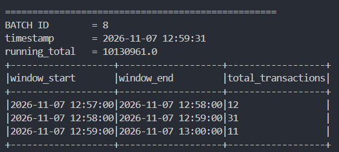
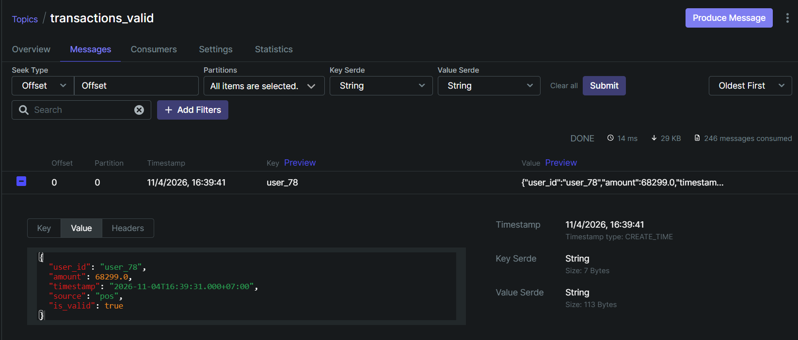
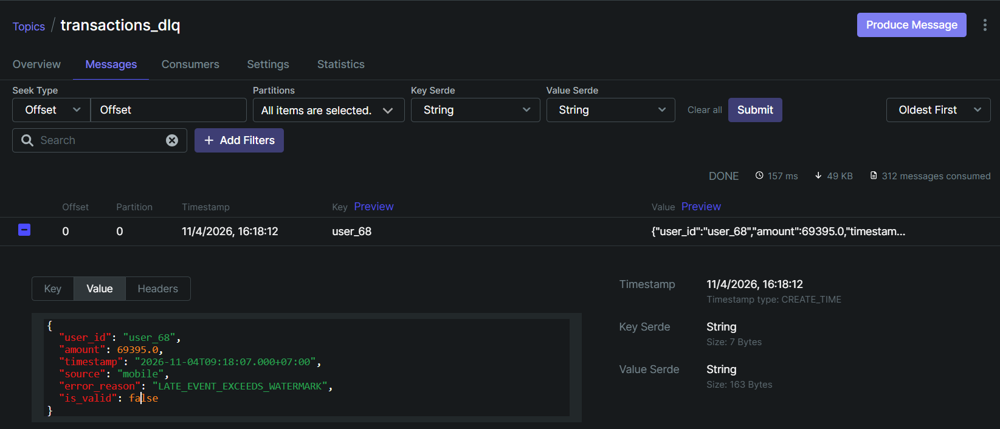
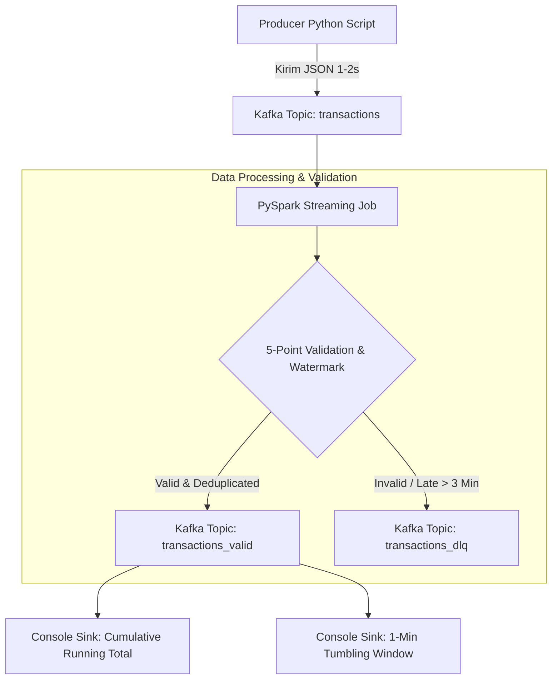

## Nama     : Ilham Zamzami
## Kelas    : DE 15

# Screenshot Project
## Screenshot Kafka producer

## Screenshot Streaming

## Screenshot Kafka UI (Output Streaming)

-----------

# Layer Detail
1. **Producer (`producer.py`)**
   * Mensimulasikan dan meng-generate event transaksi secara real-time (data valid, invalid, dan late event).
   * Mengirim dafta ke topic kafka 'transacation' dalam bentuk json dalam 1-2 detik.
2. **Streaming Job (`spark_streaming_job.py`)**
   * Membaca topic transaction yang dikirim melalui producer
   * Melakukan deserialize JSON menjadi DataFrame untuk proses Transformasi
   * Melakukan validasi data:
        * - Check mandatory field (user_id, amount, timestamp).
        * - Validasi tipe data (amount bertipe numerik).
        * - Validasi range nilai amount (Rp 1 – Rp 10.000.000).
        * - Validasi source (mobile, web, pos).
        * - Watermark detection (Event dengan timestamp terlambat > 3 menit dari waktu sistem).
   * Deduplication & Watermark: Menghapus transaksi duplikat berdasarkan kombinasi (user_id + timestamp) serta menerapkan watermark 3 menit.
   * Routing Output:
        * - Data Valid => dikirim ke Kafka topic transactions_valid.
        * - Data Invalid / Late Event => dikirim ke Kafka topic transactions_dlq (Dead Letter Queue) beserta penjelasan error_reason.
   * Aggregations & Monitoring:
        * - Menghitung running_total nominal kumulatif transaksi valid.
        * - Menghitung agregasi jumlah transaksi per 1 menit menggunakan Tumbling Window.

-----------

# Architecture Project

-----------

# Insight Bisnis
Dengan mengimplementasikan arsitektur real-time pipeline ini, perusahaan mendapatkan beberapa nilai dan insight bisnis strategis:
1. **Monitoring Arus Kas Real-Time (Live Revenue Tracking)**
   * Melalui metrik running_total, tim Finance dan manajemen dapat memantau akumulasi transaksi bersih secara live detik demi detik tanpa perlu menunggu proses agregasi batch di akhir hari.
2. **Deteksi Dini Anomali Sistem & Kualitas Data (Data Quality & Fraud Analytics)**
   * Analisis pada Kafka topic transactions_dlq memberikan visibilitas penuh terhadap kegagalan transaksi.
   * Bisnis dapat mendeteksi bug pada aplikasi (misal: user_id bernilai null), kecurangan/kesalahan input (amount negatif atau di luar range normal), hingga kegagalan format data pada channel tertentu (web, mobile, atau mesin POS).
3. **Evaluasi Latensi & Kendala Operasional Lapangan (Late Event Tracking)**
   * Transaksi yang terlempar ke DLQ karena melebihi watermark ($> 3$ menit) membantu tim IT mendeteksi kendala konektivitas/jaringan pada perangkat mesin POS ritel atau kegagalan sinkronisasi aplikasi mobile saat offline.
